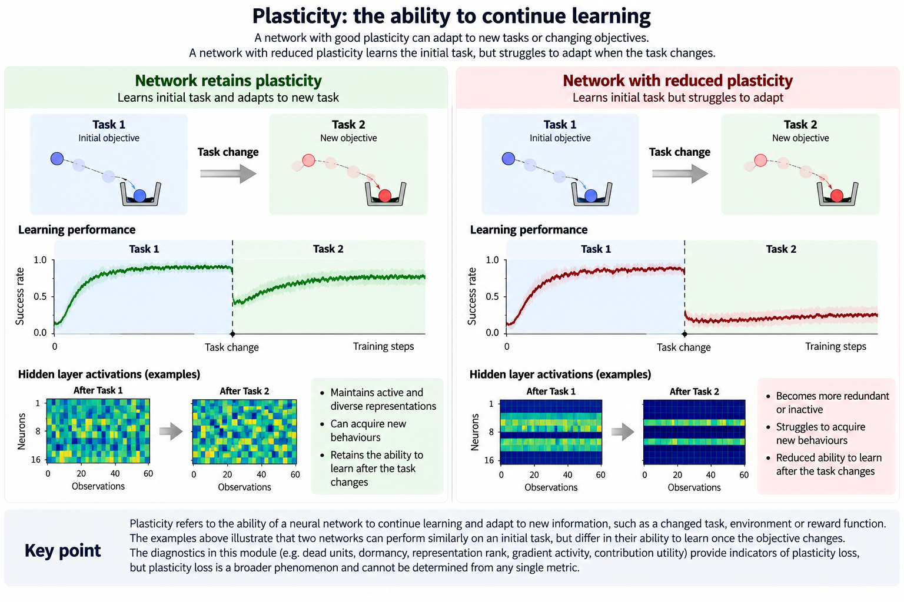
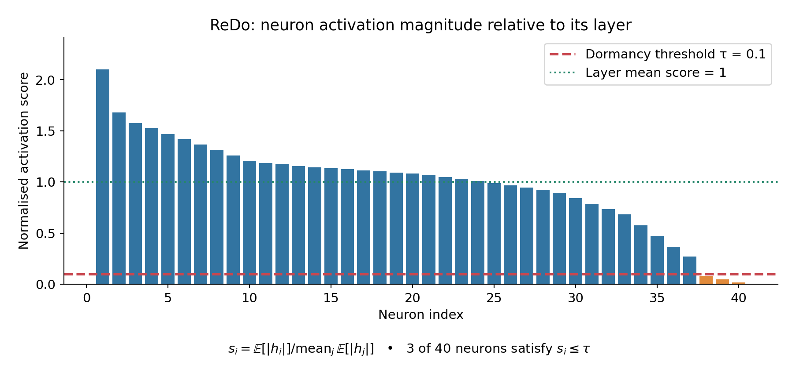
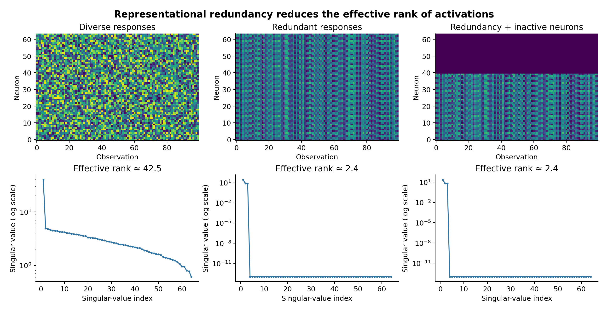
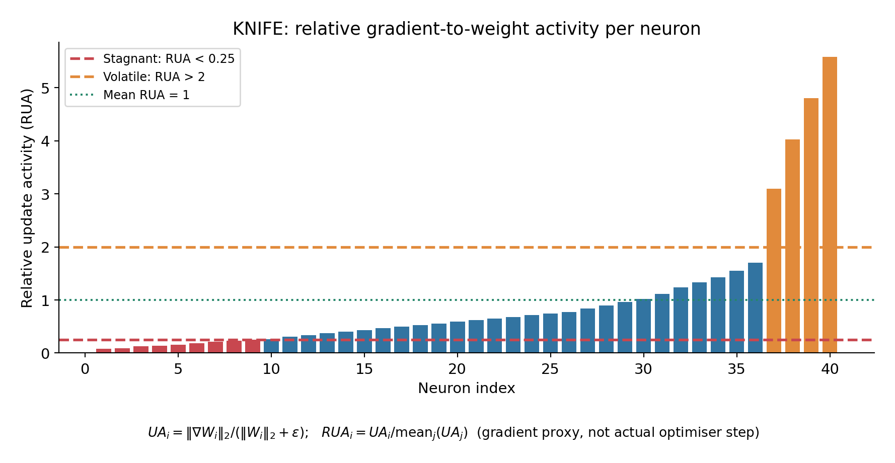
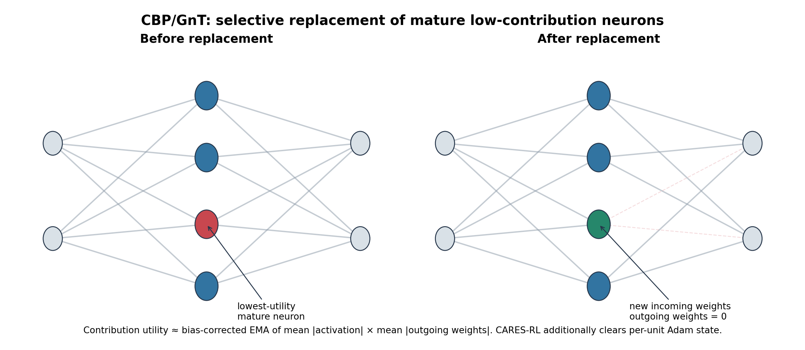

# Neural Network Plasticity

**Plasticity** is a neural network's ability to change its behaviour through further training. In reinforcement learning (RL), this matters throughout an experiment: the policy changes the data it experiences, bootstrap targets change as networks learn, and a network that performs well now may still need to learn substantially different behaviour later.

**Loss of plasticity** describes a reduction in a trained network's ability to adapt to new data or learning targets. It is not synonymous with low reward, a plateau in episode return, or small gradients. A network may stop improving because the task has been solved, because exploration is insufficient, because the optimisation objective is poorly aligned with the task, or because its ability to learn has deteriorated. Distinguishing these explanations generally requires additional experiments.

This page documents the diagnostics **currently implemented** by CARES-RL in `cares_reinforcement_learning/networks/plasticity.py`, and the optional continual-backpropagation (CBP) neuron replacement mechanism. Paper terminology and **implementation-specific definitions** are identified separately where appropriate.

!!! important "Diagnostics are indicators, not a plasticity score"
    The metrics below describe different properties of a network: activation, representation dimensionality, gradients, parameter magnitude, and neuron contribution. No individual measurement proves that a network has lost the capacity to learn. A stronger test is to measure how well the same network learns a new target or task relative to a suitable baseline.



**Figure 1. Illustration of neural network plasticity during sequential learning.** Both networks initially learn Task 1 successfully, but differ in their ability to adapt when the objective changes to Task 2. The network retaining plasticity continues learning and improves its performance, while the network with reduced plasticity struggles to acquire the new behaviour. The activation heatmaps illustrate potential differences in representation diversity and neuron activity. These are possible indicators of plasticity loss rather than definitive measures of a network's ability to learn.

## Metrics Overview

Plasticity cannot be measured through a single property of a neural network. Different approaches examine neuron activity, representation diversity, gradient behaviour, and parameter changes to identify potential signs of declining learning capacity.

The following measures provide complementary perspectives on the internal behaviour of a network. Each is explained in greater detail in the sections below.

| Measure | What does it tell us? | Source |
|---|---|---|
| **Dead neurons** | How many neurons have effectively stopped activating? Neurons that rarely activate may represent network capacity that is no longer being used. | Dohare et al. (2024) |
| **Dormant neurons** | How many neurons contribute very little activation compared with others in the same layer? Unlike dead neurons, these may still activate but at relatively small magnitudes. | Sokar et al. (2023), ReDo |
| **Representation rank** | How diverse are the features learned by the network? A low rank suggests that many neurons produce redundant representations rather than capturing distinct information. | Dohare et al. (2024); Kumar et al. (2021) |
| **Stagnant neurons** | How many neurons receive comparatively weak gradient activity relative to their weights? These neurons may still activate normally but exhibit limited learning activity. | Liu et al. (2026), KNIFE |
| **Volatile neurons** | How many neurons experience disproportionately large gradient activity relative to others in the same layer? This can indicate imbalanced optimisation dynamics. | Liu et al. (2026), KNIFE |
| **Neuron contribution** | How much influence does a neuron have through its outgoing connections? Low-contribution neurons may be candidates for replacement to maintain network capacity. | Dohare et al. (2024), CBP |
| **Weight magnitude** | How large have the network's parameters become? Increasing weight magnitudes can accompany plasticity loss and changes in optimisation behaviour. | Dohare et al. (2024) |

!!! note "Interpreting these measures"
    These measurements identify potential indicators of plasticity loss, not definitive evidence that a network has lost its ability to learn. Their interpretation depends on the network architecture, training stage, and environment. Multiple measurements considered together provide a more complete picture.

## What is actually observed?

CARES-RL discovers **feature sites** in `nn.Sequential` blocks. A site comprises a trainable `nn.Linear` layer (the *producer*), a supported activation module immediately after it, and, when available, a subsequent linear layer (the *consumer*). The output of the activation module is treated as the site's feature representation.

The supported activation modules are `ReLU`, `LeakyReLU`, `ELU`, `GELU`, `SiLU`, `Tanh`, `Sigmoid`, and CARES-RL's `GoLU`. However, some interpretations—especially “dead” neurons defined using positive activation—are most natural for ReLU. A negative `Tanh` output, for example, is not an inactive neuron merely because it is not positive.

!!! warning "Architecture coverage"
    Site discovery does **not** instrument arbitrary network graphs yet. It looks for supported layers and activations within `nn.Sequential` and currently supports `nn.Linear` producers. Convolutional producers, functional activations without a module, and more complex residual paths may not produce feature-site diagnostics. `average_weight_magnitude` is an exception: it iterates over **all** `nn.Linear` layers in the model, not just discovered feature sites.

Two explicit capture contexts keep evaluation and training observations separate:

- `capture_training()` captures activation statistics and incoming-weight gradients for ongoing training. It also stores the latest activation for CBP utility accounting.
- `capture_metrics()` collects post-activation feature matrices for recent activity and rank measurements, without updating training/lifetime activity or KNIFE gradient statistics.

## Neuron Activity and Inactivity

The terms **dead**, **dormant**, and **stagnant** describe different measurements, not interchangeable diagnoses. A neuron can activate frequently yet receive comparatively weak gradients; another may have nonzero but negligible activation relative to its neighbours. Figure 2 highlights why activity- and gradient-based diagnostics can provide complementary information.


**Figure 2. Comparison of dead, dormant, and stagnant neurons.**
The upper plots show a neuron's activation across different observations (inputs to the network), while the lower plots show its gradient activity across successive training updates. A **dead neuron** produces no activation and receives no incoming-weight gradient when its ReLU remains inactive. A **dormant neuron** produces small but nonzero activations relative to other neurons in its layer, while potentially continuing to receive gradients. A **stagnant neuron** may activate normally but exhibits low relative update activity (RUA), indicating comparatively weak incoming-weight gradients relative to its weight magnitude and other neurons in the layer. The traces are illustrative; observation index represents different inputs, not necessarily training progression.

!!! note "Neuron Activity vs. Gradient Activity"
    A neuron can be active without receiving substantial learning signals, and conversely, a neuron with relatively small activations can still receive gradients. That's the central reason for using multiple plasticity diagnostics.

### Dead Units

**Question:** How many neurons almost never produce a positive output on recent observations?

To measure neuron activity, CARES-RL records the output of each neuron across a set of observations. Let `a[b,i]` represent the activation of neuron `i` for observation `b`, where `B` is the number of observations and `H` is the number of neurons in the layer.

For each neuron, we calculate the fraction of observations where its activation is strictly positive. Neurons that rarely produce positive activations are considered inactive under this measurement:

```text
active_fraction[i] = mean_b(1[a[b, i] > 0])
dead_units_frac   = mean_i(1[active_fraction[i] <= 0.01])
```

A neuron is therefore counted as **dead for this measurement** when it is positive on at most 1% of the recorded observations. This is an **observational criterion**, not proof that the neuron can never reactivate. Both the 1% cutoff and the observation distribution matter.

The same recent activation data yield:

| Metric | Calculation |
|---|---|
| `active_fraction_mean` | Mean of `active_fraction[i]` across neurons |
| `active_fraction_p10` | 10th percentile of the per-neuron active fractions |
| `activity_window_size` | Number of recorded observations used for the recent activity calculation |

A rising `dead_units_frac`, especially together with a declining `active_fraction_p10`, may suggest that an increasing subset of neurons is rarely being used. It does **not** by itself establish permanent neuron death or impaired learning.

**Source:** Dohare et al. (2024), *Loss of Plasticity in Deep Continual Learning*. In their reinforcement-learning experiments, neuron activity is measured as the fraction of observations on which each neuron produces a positive activation. CARES-RL follows this approach, classifying neurons as inactive when they activate on at most 1% of recorded observations (`active_fraction <= 0.01`).

### ReDo Dormancy

**Question:** Which neurons produce very small activations compared with others in the same layer, even if they are not completely inactive?

Sokar et al. (2023) introduced the **ReDo dormancy score**, which measures how strongly each neuron activates relative to the average activation magnitude of its layer. Unlike the dead-unit metric, which considers how frequently a neuron produces a positive activation, ReDo considers the **magnitude of its activations relative to other neurons**.

CARES-RL maintains an exponential moving average (EMA) of each neuron's mean absolute activation magnitude across training batches:

```text
m[i] <- redo_decay * m[i] + (1 - redo_decay) * mean_b(|a[b, i]|)

score[i] = m[i] / max(mean_i(m[i]), 1e-12)

redo_dormant_units_frac = mean_i(1[score[i] <= redo_dormant_threshold])
```

The normalisation makes dormancy **relative to the layer**. A score of `1.0` indicates activation magnitude equal to the layer average, while `0.1` indicates a neuron whose activation magnitude is only 10% of that average. Neurons at or below the configured threshold are classified as dormant.

The original ReDo paper explores several thresholds, including `0`, `0.025`, and `0.1`. CARES-RL uses the configured `redo_dormant_threshold`, rather than assuming a universal threshold.



**Figure 3. ReDo dormancy from relative activation magnitude.** Each neuron's mean absolute activation is normalised by the layer mean. Neurons at or below the illustrative threshold `τ = 0.1` are classified as dormant. The figure illustrates the relative nature of dormancy; CARES-RL uses an EMA of training activations and a configurable threshold.

CARES-RL also records additional statistics that provide complementary information about neuron activity:

| Metric | Interpretation |
|---|---|
| `redo_dormancy_score_p10` | The 10th percentile of normalised activation scores. Tracks how weakly the least-active neurons respond relative to their layer, including changes that do not cross the dormancy threshold. |
| `redo_dormancy_score_mean` | The mean normalised score. Approximately `1.0` by construction whenever the layer has nonzero activity, so it primarily serves as a normalisation sanity check rather than an independent plasticity indicator. |
| `redo_activity_frac_mean` | The average frequency with which neurons produce activations exceeding a configured absolute magnitude threshold. Unlike the dormancy score, this does not normalise against other neurons in the layer. |

The distinction between **relative magnitude** and **absolute activity frequency** is important. If every neuron in a layer produces similarly small activations, their ReDo dormancy scores can remain close to `1.0`, even though the layer's absolute activation magnitudes are low.

To capture this additional perspective, CARES-RL calculates `redo_activity_frac_mean` using an EMA of the frequency with which activations exceed `redo_activity_threshold`:

```text
f[i] <- redo_decay * f[i]
        + (1 - redo_decay) * mean_b(1[|a[b, i]| > redo_activity_threshold])

redo_activity_frac_mean = mean_i(f[i])
```

For example, two layers whose neurons consistently produce activations around `1.0` and `0.001`, respectively, could have similar ReDo dormancy scores. However, with an absolute activity threshold of `0.01`, the second layer would have a much lower `redo_activity_frac_mean`.

This additional metric measures **how frequently neurons exceed a minimum activation magnitude**, not the magnitude itself. A neuron consistently producing `0.02` and one consistently producing `10.0` would both have an activity frequency of `1.0` when the threshold is `0.01`.

!!! note "Implementation and interpretation"
    - **ReDo implementation:** The original ReDo score is defined using expected activation magnitudes over an input distribution. CARES-RL approximates this using an EMA of training-batch activation magnitudes rather than a fixed observation dataset.
    - **Additional diagnostic:** `redo_activity_frac_mean` is a CARES-RL extension, not part of the original ReDo dormancy definition. Its interpretation depends on the configured absolute threshold, network architecture, and activation function.
    - **Observation source:** Both measurements use training activations rather than the recent environment observations used by `dead_units_frac`. Their responsiveness to changes depends on `redo_decay`.
    - **Zero-activation case:** If every neuron has zero activation magnitude, the numerical stabiliser produces a dormancy score of zero for every neuron. For non-negative dormancy thresholds, all neurons are consequently classified as dormant.

## Representation diversity

Representation diversity describes how much independent information is captured by the activations of neurons within a layer. A network may have many active neurons, but if they respond similarly to the same observations, they may provide largely redundant representations.

To measure this, CARES-RL constructs an activation matrix `A \in \mathbb{R}^{B \times H}`, where each row represents an observation and each column represents a neuron. The matrix contains the post-activation outputs collected through `capture_metrics()`.

The rank-based metrics examine the singular values of this matrix, which describe how its representations are distributed across different directions. CARES-RL calculates these values from the **uncentred activation matrix**, with up to `\min(B,H)` singular values arranged in descending order.



**Figure 4. Representation diversity and rank.** Each heatmap depicts responses of multiple neurons to multiple observations; its associated spectrum shows the singular values of that feature matrix. When many neurons follow repeated or dependent response patterns, the spectrum becomes concentrated in fewer directions, reducing effective dimensionality. **The example is conceptual:** the exact numerical rank depends on the feature matrix and the rank definition, which are specified below.

This illustrates why the number of *active neurons* is not the same as the number of *independent features*: several neurons may fire strongly while encoding nearly identical variation across inputs.

### `stable_rank` — 99% cumulative singular-value rank

```text
p[j] = s[j] / sum_k(s[k])

stable_rank = smallest K such that sum_(j=1..K)(p[j]) >= 0.99
stable_rank_pct = 100 * stable_rank / H
```

The logged name is preserved as **`stable_rank`**, but the implementation is specifically a **99% cumulative singular-value rank**. This is important when comparing papers: it is **not** the conventional mathematical stable rank `||A||_F² / ||A||_2²`, and it should not be assumed equivalent to threshold-counting definitions also called “stable rank”.

Higher values mean that more singular directions are needed to account for 99% of the singular-value sum. `stable_rank_pct` scales by the **number of units in the layer**, not by `min(B, H)`.

### `effective_rank` — entropy-based rank

```text
p[j] = s[j] / sum_k(s[k])
entropy = -sum_j(p[j] * log(p[j]))
effective_rank = exp(entropy)
```

This measures the effective number of represented directions while taking the **entire singular-value distribution** into account. Concentrating almost all singular-value mass in one direction drives the result toward 1; more uniform singular values yield a higher effective rank.

The entropy-based effective rank is described in Dohare et al. (2024). ReDo also reports an effective-rank analysis in Appendix C.5, Table 7, following Kumar et al. (2021). The appearance of a rank measure in multiple papers does **not** imply that their implementations are identical without verifying the precise construction and normalisation.

| Aspect | `stable_rank` | `effective_rank` |
|---|---|---|
| CARES-RL computation | Minimum count capturing 99% of singular-value **sum** | Exponential Shannon entropy of normalised singular values |
| Explicit cutoff | Yes: 99% | No cumulative cutoff |
| Output | Integer-like dimension count (`float` in logs) | Continuous effective dimension count |
| Sensitive to | Number of small singular values needed to cross 99% | Overall concentration/evenness of singular values |

If the activation matrix contains fewer than two observations, neither rank metric is emitted. If all singular values are zero, both ranks (and `stable_rank_pct`) are reported as zero. Singular-value decomposition failures are skipped rather than propagated as diagnostic errors.

!!! warning "Comparing ranks across runs"
    Rank is bounded by the available number of samples as well as by layer width. A short observation window can make a wide layer appear rank-deficient. The matrix is **not mean-centred**, so a strong shared activation offset may dominate the singular-value spectrum. Interpret trajectories only alongside the window size, layer width, observation distribution, and the fixed 99% threshold.

**Source and attribution:** Rank-related analyses appear in Dohare et al. (2024), and effective rank is also used by Sokar et al. (2023). The formulas above describe **the code as written**; in particular, the 99% cumulative formula should not be presented as an independently verified exact definition from Dohare's paper.

## Learning activity: KNIFE

**Question:** Are neurons' incoming weights still receiving meaningful gradients, relative to the size of those weights?

Following the update-activity and relative-update-activity terminology of Liu et al. (2026), CARES-RL records the L2 norm of the **incoming-weight gradient row** relative to the corresponding weight row:

```text
UA[i, t] = ||grad_W[i, :]||_2 / (||W[i, :]||_2 + knife_eps)
```

It averages these values over captured backward passes, then normalises within each layer:

```text
mean_UA[i] = mean_over_captured_backwards(UA[i, t])
RUA[i] = mean_UA[i] / max(mean_i(mean_UA[i]), 1e-12)
```



**Figure 5. KNIFE-style gradient activity.** For each neuron, CARES-RL divides the L2 norm of its incoming-weight gradient by the L2 norm of the corresponding weights, then averages across recorded backward passes and normalises by the layer mean to obtain relative update activity (RUA). Low-RUA neurons are classified as *stagnant* and high-RUA neurons as *volatile*, using the configured thresholds (illustrated here with 0.25 and 2.0). **RUA measures gradient activity, not the actual optimiser parameter step.**

Because RUA is relative to other units in the same layer, the classifications indicate an imbalance in gradient activity, not an absolute guarantee that a neuron has stopped learning or is updating unstably.

| Metric | Calculation |
|---|---|
| `knife_update_activity_mean` | Layer mean of `mean_UA[i]` |
| `knife_rua_mean` | Layer mean of `RUA[i]` |
| `knife_rua_p10` | 10th percentile of `RUA[i]` |
| `knife_stagnant_units_frac` | Fraction with `RUA[i] < knife_stagnant_threshold` |
| `knife_volatile_units_frac` | Fraction with `RUA[i] > knife_volatile_threshold` |

The same metrics are available with a **`_lifetime` component** in their names—for example, `knife_update_activity_lifetime_mean`, `knife_rua_lifetime_p10`, and `knife_stagnant_units_lifetime_frac`. They use the accumulated lifetime mean rather than the latest summary window.

A **stagnant** neuron receives comparatively small incoming-weight gradients; a **volatile** neuron receives comparatively large ones. These are *relative within a layer*: a neuron can have low raw update activity while having a normal RUA if every unit has similarly small gradients. In non-degenerate cases, the **mean RUA is approximately 1 by construction**, so its lower tail and the stagnant/volatile fractions are usually more informative than `knife_rua_mean` alone.

!!! important "Gradient activity is not an optimizer step"
    `UA` is calculated from the raw gradient available to the parameter hook and the current weights. It is **not** the actual parameter change made by Adam or another optimiser. Learning rate, optimiser moments, clipping, regularisation, and other update rules can affect parameter movement. A stagnant RUA therefore does not by itself prove that a unit is incapable of learning, while a high RUA does not necessarily mean unstable learning.

The implementation **omits KNIFE metrics** when no unit has positive mean update activity. This differs from interpreting missing keys as numerical zeros. The stagnant and volatile comparisons use strict `<` and `>` respectively; a neuron exactly on a threshold is not included.

**Source:** Liu et al. (2026), *Stagnant Neuron: Towards Understanding the Plasticity Loss in Multi-Agent Reinforcement Learning Value Factorization Methods*. See the referenced implementation comments for the specific UA/RUA mapping.

## Neuron contribution and continual backpropagation

### Contribution utility

**Question:** How much influence can each neuron's activation have through its outgoing connections?

The CBP/GnT contribution-utility signal combines absolute activation magnitude with the average absolute magnitude of outgoing weights:

```text
instantaneous_utility[i]
    = mean_b(|a[b, i]|) * mean_output_units(|W_consumer[:, i]|)

utility_ema[i] <- cbp_utility_decay * utility_ema[i]
                  + (1 - cbp_utility_decay) * instantaneous_utility[i]

contribution_utility[i]
    = utility_ema[i] / max(1 - cbp_utility_decay ** age[i], 1e-12)
```

For explicitly included sites with **no consumer layer**, the code uses activation magnitude alone as instantaneous utility. Such sites do not participate in CBP replacement.

The utility is updated in `step_replacement()` **after the optimiser step**, using the saved preceding training activation and the **updated** outgoing weights. This timing matters: it follows the generate-and-test ordering implemented by CARES-RL rather than updating utility on every forward hook.

| Metric | Calculation |
|---|---|
| `contribution_utility_mean` | Mean bias-corrected utility across neurons |
| `contribution_utility_p10` | 10th percentile of utilities |
| `contribution_utility_min` | Smallest neuron utility |

Low utility identifies neurons with relatively little estimated contribution through their immediate outgoing weights. It does **not** directly measure the effect of a neuron on return, its usefulness for future tasks, or the causality of plasticity loss. The magnitude depends on architecture and weight/activation scales, so comparing raw values across different networks requires care.

**Source:** CBP/GnT contribution utility, associated with Dohare et al. (2024).

### Optional replacement — `step_replacement()`

The diagnostic manager can also **intervene** by replacing low-utility neurons; measurement and intervention should be kept conceptually separate.

When `replacement_enabled=True`, the current implementation supports `replacement_strategy="cbp"`. The replacement procedure:

1. Updates each site's contribution utility and age using the most recent captured training activation.
2. Selects eligible units (`age > maturity_threshold_updates`) with the lowest utility, according to `replacement_rate` and the configured stochastic or accumulated replacement scheme.
3. Adds the removed neuron's estimated mean contribution to the consumer bias (when present), then zeroes its outgoing weights.
4. Reinitialises the neuron's incoming weight row and zeroes its producer bias.
5. Resets that unit's stored utility, activity, ReDo and KNIFE statistics, as well as the corresponding per-unit optimiser state.

The module requires `PlasticityAdam` when replacement is enabled, so it can reset the optimiser's per-parameter-element state. `units_replaced` reports the count returned by that replacement call; `units_replaced_total` reports the running count. `summary()` also includes the cumulative total.



**Figure 6. Contribution-based neuron replacement.** CARES-RL tracks a running estimate of each neuron's activation magnitude multiplied by its outgoing-weight magnitude. Among mature, eligible neurons, the lowest-utility units can be selected at the configured replacement rate. A selected neuron's incoming weights are reinitialised and its outgoing weights zeroed; CARES-RL also clears the corresponding optimiser and diagnostic state. The diagram is a schematic of the intervention, not a guarantee that replacement will improve learning.

The distinction between the **selection criterion** (contribution utility) and the **intervention** (reinitialisation and zeroing outgoing connections) matters: a neuron is not chosen merely because it has a small gradient or because it appears dead under the activity metric.

!!! note "Recording utility without replacing neurons"
    `step_replacement()` still updates CBP/GnT utility when the manager is enabled but `replacement_enabled=False`; it simply performs no replacements. Thus training code must invoke that method for contribution-utility statistics to advance, even when no neuron reset is desired.

An improvement after replacement is evidence that the intervention helped **under the tested conditions**, not proof that every low-utility neuron was permanently non-functional.

## Weight magnitude

`average_weight_magnitude` is the mean absolute value of the weight entries in an `nn.Linear` layer:

```text
average_weight_magnitude[layer] = mean(|W_layer|)
```

The network-wide `average_weight_magnitude` is a **weight-count-weighted** average across all linear layers; it is not simply the average of the per-layer means. Bias parameters are not included.

Growing weight magnitudes can accompany changes in optimisation dynamics or activation saturation, but large weights alone are not a demonstration of plasticity loss. Layer scales, activation functions, and normalisation all affect their meaning.

**Source:** Weight-magnitude analyses in Dohare et al. (2024).

## Reading several metrics together

| Pattern to investigate | Possible explanation | What it does **not** establish |
|---|---|---|
| `dead_units_frac` rises; `redo_dormant_units_frac` rises | More units are silent or weak relative to their layer | That the units can never recover |
| Activity remains high; ranks decline | Neurons may be active but increasingly redundant | That task performance or learning capacity must decline |
| Activity is healthy; `knife_stagnant_units_frac` rises | Incoming-weight gradient activity is concentrated in fewer units | That actual optimiser updates are zero |
| Low `contribution_utility_p10`; high activity | Some active neurons may have weak outgoing influence | That those neurons are useless for future learning |
| Rank or activity looks healthy; performance plateaus | Another bottleneck—exploration, target quality, optimisation, or task difficulty—may dominate | That plasticity loss is absent |
| Weight magnitude grows while activity/rank falls | A possible joint change in parameter scale and representation | A causal mechanism without further experiments |

!!! tip "A practical diagnostic workflow"
    Compare metrics **over training**, not just at one checkpoint, and correlate them with evaluation performance. Compare equivalent sites and sampling conditions across seeds. If plasticity loss is suspected, test adaptation to a controlled **new learning target** and compare with a freshly initialised or appropriately reset network. Such interventions offer stronger functional evidence than any activation- or gradient-side proxy alone.

## Reporting, naming, and aggregation
Most activity, dormancy, and stagnation fractions are reported on a **0–1 scale**, where `0.25` represents 25% of neurons. The exception is `stable_rank_pct`, which is reported on a **0–100 scale**.

Other measurements, such as effective rank, contribution utility, and weight magnitude, have their own scales and should not be interpreted as percentages.

### Reporting paths

Per-site metrics use the key form:

```text
<manager-name>/<site-name>/<metric-name>
```

Dots in a discovered site's name are replaced with underscores. For example, a site named `encoder.0` produces keys such as `agent/encoder_0/dead_units_frac` when the manager is named `agent`. Network-level aggregates instead use keys such as `agent/dead_units_frac`.

`summary(env_step, prefix=None, force=False)` chooses between three independently scheduled groups:

| Config option | Governs |
|---|---|
| `statistics_interval_env_steps` | Regular activity, ReDo, utility metrics; window resets |
| `rank_enabled`, `rank_interval_env_steps` | Rank computation on the activity observation window |
| `knife_interval_env_steps` | KNIFE summary and gradient-window resets |
| `force=True` | Requests all groups (rank still requires `rank_enabled`) |

**Important detail:** When a summary is triggered *only* for rank or KNIFE, not every other diagnostic is necessarily reported. The function still reports the weight-magnitude metrics and cumulative replacement count whenever a summary occurs.

### Recent windows and lifetime histories

The code maintains three distinct data histories:

| Source | Collected by | Used for | Reset behaviour |
|---|---|---|---|
| Recent observation chunks | `capture_metrics()` | `dead_units_frac`, active fractions, rank | Cleared after a statistics summary **if the model is training** |
| Training activity running averages | `capture_training()` | Lifetime dead/active metrics | Recent averages reset on a statistics summary; lifetime averages persist until neuron replacement |
| Training gradient running averages | `capture_training()` backward hook | KNIFE recent/lifetime metrics | Recent averages reset on a KNIFE summary; lifetime averages persist until neuron replacement |

`activity_window_env_steps` caps the **returned observation matrix** for the recent window. Chunks are stored on CPU, and the implementation removes entire old chunks; the total temporarily stored can therefore differ from an exact row-by-row sliding-window buffer. Calling `summary()` while the model is **not in training mode** does not clear recent windows.

ReDo and contribution utility instead maintain **EMAs**; they are not cleared by ordinary summary calls. Their rates are controlled by `redo_decay` and `cbp_utility_decay`, respectively.

### Aggregation across sites

CARES-RL uses **different aggregations for different quantities**:

| Family | Network-wide calculation | Example |
|---|---|---|
| Fractions and selected means | Mean of site values weighted by the site's number of neurons | `<prefix>/dead_units_frac`, `<prefix>/redo_dormant_units_frac` |
| Rank | Simple mean across sites with reported ranks; final available site's value also logged | `<prefix>/stable_rank_mean`, `<prefix>/effective_rank_final_layer` |
| Utility / KNIFE low tails | Average of site 10th percentiles **and** 10th percentile from all collected neuron-level values | `<prefix>/contribution_utility_p10_mean`, `<prefix>/contribution_utility_p10_global` |
| Weight magnitude | Mean weighted by **number of weight elements** | `<prefix>/average_weight_magnitude` |

The `_final_layer` rank output means the **last site that supplied that metric in discovered-site order**; it does not infer an architectural semantic label.

!!! warning "Interpreting aggregates"
    Site-level values are often the safest starting point, particularly when layers have different widths. In the current `_weighted_site_mean()` implementation, the denominator is the total units in **all supplied sites**, even if some sites do not report a particular metric. When metric availability varies between sites, that network average can be biased downward. This is a **current implementation caveat**, not a definition to generalise to other tools.

## Configuration reference

The following `PlasticityConfig` fields are **read by the current implementation**. The table intentionally does not invent default values; consult `algorithm/configurations.py` for the installed version's defaults.

| Setting | Purpose |
|---|---|
| `enabled` | Enables manager instrumentation |
| `training_only` | Restricts training capture to a model in training mode |
| `include_output_layer` | Allows sites without a downstream consumer |
| `activity_window_env_steps` | Recent feature-matrix observation capacity |
| `statistics_interval_env_steps` | Activity/ReDo/utility reporting interval |
| `rank_enabled` | Enables rank metrics |
| `rank_interval_env_steps` | Rank reporting interval |
| `redo_decay` | ReDo activation EMA decay |
| `redo_dormant_threshold` | ReDo relative activation-score threshold |
| `redo_activity_threshold` | Absolute activation threshold for the additional frequency diagnostic |
| `knife_interval_env_steps` | KNIFE reporting interval |
| `knife_eps` | Denominator stabiliser for update activity |
| `knife_stagnant_threshold` | RUA cutoff below which neurons are stagnant |
| `knife_volatile_threshold` | RUA cutoff above which neurons are volatile |
| `cbp_utility_decay` | Contribution-utility EMA decay |
| `replacement_enabled` | Enables CBP replacement intervention |
| `replacement_strategy` | Current supported strategy: `cbp` |
| `maturity_threshold_updates` | Minimum age for eligible replacement |
| `replacement_rate` | Expected fraction of eligible units to replace per call |
| `replacement_accumulate` | Deterministic accumulation versus stochastic fractional replacement |
| `replacement_init` | Incoming-weight initialisation scheme |
| `replacement_activation` | Activation gain used in some initialisation schemes |

## References

1. **Dohare et al. (2024).** *Loss of Plasticity in Deep Continual Learning.* **Nature** 632, 768–774. [Nature article](https://doi.org/10.1038/s41586-024-07711-7). Background for dead/inactive units, rank diagnostics, weight magnitude, and continual backpropagation.
2. **Sokar et al. (2023).** *The Dormant Neuron Phenomenon in Deep Reinforcement Learning.* **ICML 2023**, PMLR 202. [Paper](https://proceedings.mlr.press/v202/sokar23a.html). Dormancy score: Section 3, Equation (1). ReDo: Section 4. Effective-rank comparison: Appendix C.5, Table 7.
3. **Liu et al. (2026).** *Stagnant Neuron: Towards Understanding the Plasticity Loss in Multi-Agent Reinforcement Learning Value Factorization Methods.* [arXiv:2606.25335](https://arxiv.org/abs/2606.25335). KNIFE UA/RUA terminology and stagnant/volatile neurons, as referenced by the CARES-RL implementation.
4. **Nikishin et al. (2023).** *Deep Reinforcement Learning with Plasticity Injection.* **NeurIPS 2023**. [NeurIPS proceedings](https://proceedings.neurips.cc/paper_files/paper/2023). A related *intervention* for studying and alleviating loss of plasticity; plasticity injection is **not implemented** by `NetworkPlasticityManager`.

The currently documented manager does **not** implement SimBa's separate dormant-ratio, threshold-based s-rank, or L2-feature-norm diagnostics. Those should not be confused with ReDo dormancy or the existing CARES-RL rank calculations.