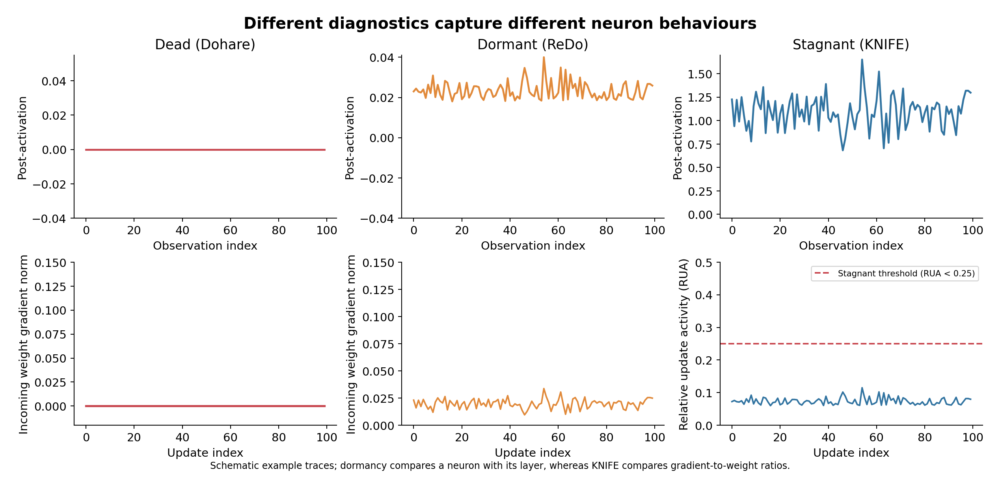
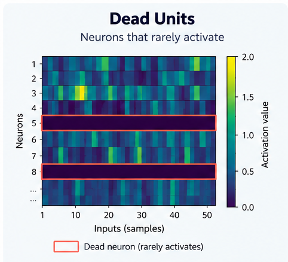
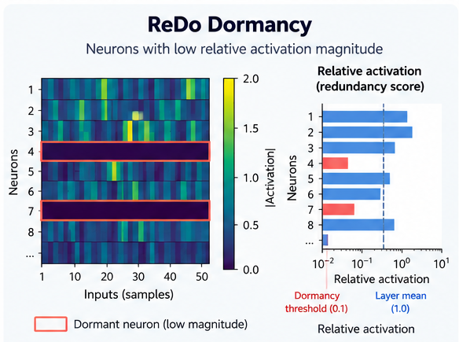
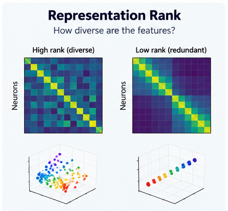
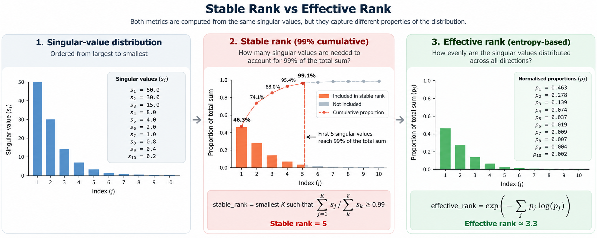
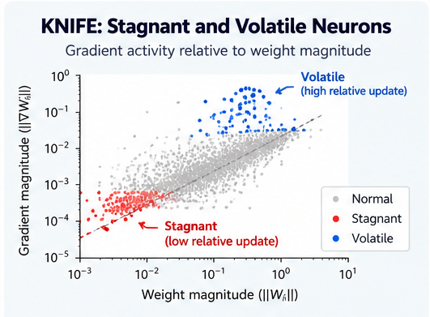
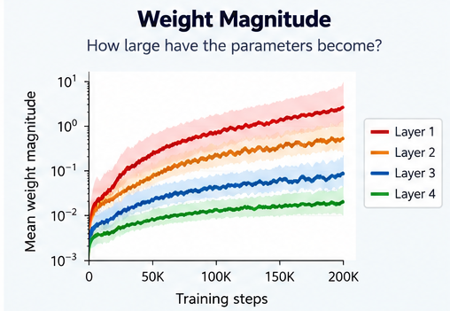
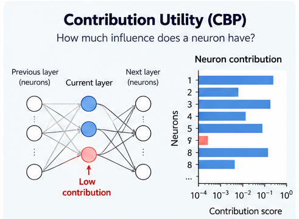

# Neural Network Plasticity

This page documents the plasticity diagnostics and maintenance methods currently implemented in CARES-RL, drawing on established approaches for measuring and addressing plasticity loss in neural networks.

**Plasticity** is a neural network's ability to change its behaviour through further training. In reinforcement learning (RL), this matters throughout an experiment: the policy changes the data it experiences, bootstrap targets change as networks learn, and a network that performs well now may still need to learn substantially different behaviour later.

**Loss of plasticity** describes a reduction in a trained network's ability to adapt to new data or learning targets. It is not synonymous with low reward, a plateau in episode return, or small gradients. A network may stop improving because the task has been solved, because exploration is insufficient, because the optimisation objective is poorly aligned with the task, or because its ability to learn has deteriorated. Distinguishing these explanations generally requires additional experiments.

This page documents the diagnostics **currently implemented** by CARES-RL in `cares_reinforcement_learning/networks/plasticity.py`, and the optional continual-backpropagation (CBP) neuron replacement mechanism. Paper terminology and **implementation-specific definitions** are identified separately where appropriate.

!!! important "Diagnostics are indicators, not a plasticity score"
    The metrics below describe different properties of a network: activation, representation dimensionality, gradients, parameter magnitude, and neuron contribution. No individual measurement proves that a network has lost the capacity to learn. A stronger test is to measure how well the same network learns a new target or task relative to a suitable baseline.


**Figure 1. Conceptual illustration of healthy and restricted network representations.** The contrasting activation patterns illustrate how a network may use diverse neuron responses or rely on fewer, more redundant responses. Such patterns may accompany loss of plasticity, but they do not directly establish whether a network can adapt to a new task.

## Metrics Overview

The following diagnostics examine different properties of a network during training, from neuron activations and representation rank to gradient activity and parameter magnitude. The methods are described individually below, with continual backpropagation (CBP) presented separately as an intervention.

| Measure | What does it tell us? | Source |
|---|---|---|
| **Dead neurons** | How many neurons have effectively stopped activating? Neurons that rarely activate may represent network capacity that is no longer being used. | Dohare et al. (2024) |
| **Dormant neurons** | How many neurons contribute very little activation compared with others in the same layer? Unlike dead neurons, these may still activate but at relatively small magnitudes. | Sokar et al. (2023), ReDo |
| **Representation rank** | How diverse are the features learned by the network? A low rank suggests that many neurons produce redundant representations rather than capturing distinct information. | Dohare et al. (2024); Kumar et al. (2021) |
| **Stagnant neurons** | How many neurons receive comparatively weak gradient activity relative to their weights? These neurons may still activate normally but exhibit limited learning activity. | Liu et al. (2026), KNIFE |
| **Volatile neurons** | How many neurons experience disproportionately large gradient activity relative to others in the same layer? This can indicate imbalanced optimisation dynamics. | Liu et al. (2026), KNIFE |
| **Neuron contribution** | How much influence does a neuron have through its outgoing connections? Low-contribution neurons may be candidates for replacement to maintain network capacity. | Dohare et al. (2024), CBP |
| **Weight magnitude** | How large have the network's parameters become? Increasing weight magnitudes can accompany plasticity loss and changes in optimisation behaviour. | Dohare et al. (2024) |

## Plasticity Diagnostics Metrics

The following measurements are drawn from several approaches to investigating plasticity loss. **Dead**, **dormant**, and **stagnant** neurons have distinct operational definitions; Figure 2 compares these neuron-level phenomena. Representation rank and weight magnitude provide additional perspectives beyond individual neuron classifications.



**Figure 2. Comparison of dead, dormant, and stagnant neurons.**
The upper plots show a neuron's activation across different observations (inputs to the network), while the lower plots show its gradient activity across successive training updates. A **dead neuron** produces no activation and receives no incoming-weight gradient when its ReLU remains inactive. A **dormant neuron** produces small but nonzero activations relative to other neurons in its layer, while potentially continuing to receive gradients. A **stagnant neuron** may activate normally but exhibits low relative update activity (RUA), indicating comparatively weak incoming-weight gradients relative to its weight magnitude and other neurons in the layer. The traces are illustrative; observation index represents different inputs, not necessarily training progression.

!!! note "Activation is not learning"
    Neuron activation and gradient activity are different quantities: a neuron may activate frequently while receiving weak gradients, or have relatively small activations while still receiving gradients.

### Dead Units — Dohare et al.

**Question:** How many neurons almost never produce a positive output on recent observations?



**Figure 3. Dead units: infrequent activation.** The heatmap shows neuron responses across sampled observations, with highlighted rows representing units that rarely activate. CARES-RL classifies a neuron as dead when its activation is positive on at most 1% of recent observations; the example values are illustrative.

To measure neuron activity, CARES-RL records the output of each neuron across a set of observations. Let `a[b,i]` represent the activation of neuron `i` for observation `b`, where `B` is the number of observations and `H` is the number of neurons in the layer.

For each neuron, we calculate the fraction of observations where its activation is strictly positive. Neurons that rarely produce positive activations are considered inactive under this measurement:

```text
active_fraction[i] = mean_b(1[a[b, i] > 0])
dead_units_frac   = mean_i(1[active_fraction[i] <= 0.01])
```

A neuron is therefore counted as **dead for this measurement** when it is positive on at most 1% of the recorded observations. This is an **observational criterion**, not proof that the neuron can never reactivate. Both the 1% cutoff and the observation distribution matter.

The same recent activation data yield:

| Metric | Calculation |
|---|---|
| `active_fraction_mean` | Mean of `active_fraction[i]` across neurons |
| `active_fraction_p10` | 10th percentile of the per-neuron active fractions |
| `activity_window_size` | Number of recorded observations used for the recent activity calculation |

A rising `dead_units_frac`, especially together with a declining `active_fraction_p10`, may suggest that an increasing subset of neurons is rarely being used. It does **not** by itself establish permanent neuron death or impaired learning.

**Source:** Dohare et al. (2024), *Loss of Plasticity in Deep Continual Learning*. In their reinforcement-learning experiments, neuron activity is measured as the fraction of observations on which each neuron produces a positive activation. CARES-RL follows this approach, classifying neurons as inactive when they activate on at most 1% of recorded observations (`active_fraction <= 0.01`).

### ReDo Dormancy — Sokar et al.

**Question:** Which neurons produce very small activations compared with others in the same layer, even if they are not completely inactive?



Sokar et al. (2023) introduced the **ReDo dormancy score**, which measures how strongly each neuron activates relative to the average activation magnitude of its layer. Unlike the dead-unit metric, which considers how frequently a neuron produces a positive activation, ReDo considers the **magnitude of its activations relative to other neurons**.

CARES-RL measures ReDo dormancy **on training batches**, using an exponential moving average (EMA) of each neuron's mean absolute activation magnitude across captured training forwards. The EMA gives recent batches more weight while retaining diminishing contributions from older batches; **it is not a fixed-length sliding window**:

```text
m[i] <- redo_decay * m[i] + (1 - redo_decay) * mean_b(|a[b, i]|)

score[i] = m[i] / max(mean_i(m[i]), 1e-12)

redo_dormant_units_frac = mean_i(1[score[i] <= redo_dormant_threshold])
```

The normalisation makes dormancy **relative to the layer**. A score of `1.0` indicates activation magnitude equal to the layer average, while `0.1` indicates a neuron whose activation magnitude is only 10% of that average. Neurons at or below the configured threshold are classified as dormant.

The original ReDo paper explores several thresholds, including `0`, `0.025`, and `0.1`. CARES-RL uses the configured `redo_dormant_threshold`, rather than assuming a universal threshold.

**Figure 4. ReDo dormancy: low relative activation magnitude.** Some neurons respond much more weakly than others in the same layer. Their mean absolute activations are normalised by the layer mean, and low-scoring units are classified as dormant. The diagram illustrates a threshold of `0.1`; CARES-RL applies its configured threshold to EMA-smoothed training activations.

CARES-RL also records additional statistics that provide complementary information about neuron activity:

| Metric | Interpretation |
|---|---|
| `redo_dormancy_score_p10` | The 10th percentile of normalised activation scores. Tracks how weakly the least-active neurons respond relative to their layer, including changes that do not cross the dormancy threshold. |
| `redo_dormancy_score_mean` | The mean normalised score. Approximately `1.0` by construction whenever the layer has nonzero activity, so it primarily serves as a normalisation sanity check rather than an independent plasticity indicator. |
| `redo_activity_frac_mean` | The average frequency with which neurons produce activations exceeding a configured absolute magnitude threshold. Unlike the dormancy score, this does not normalise against other neurons in the layer. |

The distinction between **relative magnitude** and **absolute activity frequency** is important. If every neuron in a layer produces similarly small activations, their ReDo dormancy scores can remain close to `1.0`, even though the layer's absolute activation magnitudes are low.

To capture this additional perspective, CARES-RL calculates `redo_activity_frac_mean` using an EMA of the frequency with which activations exceed `redo_activity_threshold`:

```text
f[i] <- redo_decay * f[i]
        + (1 - redo_decay) * mean_b(1[|a[b, i]| > redo_activity_threshold])

redo_activity_frac_mean = mean_i(f[i])
```

For example, two layers whose neurons consistently produce activations around `1.0` and `0.001`, respectively, could have similar ReDo dormancy scores. However, with an absolute activity threshold of `0.01`, the second layer would have a much lower `redo_activity_frac_mean`.

This additional metric measures **how frequently neurons exceed a minimum activation magnitude**, not the magnitude itself. A neuron consistently producing `0.02` and one consistently producing `10.0` would both have an activity frequency of `1.0` when the threshold is `0.01`.

!!! note "Implementation and interpretation"
    - **ReDo implementation:** The original ReDo method estimates expected neuron activation magnitudes from sampled observations (typically training/replay data in off-policy RL). CARES-RL uses the same relative score but smooths the per-batch magnitudes with an EMA, so it responds more gradually to changes. It currently logs this **EMA-based** score, not a separate immediate, latest-batch score.
    - **Additional diagnostic:** `redo_activity_frac_mean` is a CARES-RL extension, not part of the original ReDo dormancy definition. Its interpretation depends on the configured absolute threshold, network architecture, and activation function.
    - **Observation source:** Both measurements use training activations rather than the recent environment observations used by `dead_units_frac`. Their responsiveness to changes depends on `redo_decay`.
    - **Zero-activation case:** If every neuron has zero activation magnitude, the numerical stabiliser produces a dormancy score of zero for every neuron. For non-negative dormancy thresholds, all neurons are consequently classified as dormant.

### Representation Rank — Dohare et al.

**Question:** How many independent directions are represented by a layer's neuron activations, and are neurons producing redundant features?



**Figure 5. Representation rank: diverse versus redundant features.** Higher-rank representations span more independent directions, whereas redundant neuron responses concentrate activity in fewer directions. The examples illustrate how neurons can remain active while providing limited representational diversity.

A neural network learns by developing internal representations of the observations it receives. Ideally, different neurons respond to different features or patterns in those observations, allowing the network to distinguish between a wide variety of situations.

However, **having many active neurons does not necessarily mean the network has diverse representations**. For example, imagine a layer containing 100 neurons, but most of them respond in almost exactly the same way to every observation. Although all 100 neurons may be active, they provide largely redundant information. In contrast, a layer whose neurons respond to different patterns can represent a greater variety of information.

**Representation rank measures the dimensionality of these activation patterns.** A higher rank indicates that neuron responses span more independent directions, while a lower rank indicates that activity is concentrated in fewer directions. This makes rank useful for identifying when a network's internal representations are becoming increasingly redundant, even if its neurons remain active.

To calculate this, CARES-RL collects neuron activations across multiple observations using `capture_metrics()`. These are arranged into an activation matrix `A` of shape `[B, H]`, where `B` is the number of observations and `H` is the number of neurons in the layer. Each row represents one observation, and each column records how a particular neuron responds across those observations.

CARES-RL then uses Singular Value Decomposition (SVD) to examine how the activation patterns are distributed across different directions. The resulting **singular values** indicate the relative strength of those directions. If most of the activity is concentrated in a few directions, the representation has a lower effective dimensionality. If activity is distributed across many directions, the representation has a higher effective dimensionality.

Two complementary measurements, **stable rank** and **effective rank**, summarise this distribution in different ways. Both are calculated from the singular values of the **uncentred activation matrix**, producing up to `min(B, H)` singular values.

#### Stable Rank

**Question:** How many of the strongest activation patterns are needed to account for 99% of the total singular-value magnitude?

CARES-RL calculates `stable_rank` by ordering the singular values from largest to smallest and progressively adding them together. Once their cumulative sum reaches **99% of the total**, the number of directions included becomes the reported rank.

For example, if a layer has 100 neurons but just 10 directions account for 99% of the singular-value sum, the reported rank is 10. This suggests that the layer's activations are concentrated in relatively few directions, despite having 100 neurons.

```text
p[j] = s[j] / sum_k(s[k])

stable_rank = smallest K such that sum_(j=1..K)(p[j]) >= 0.99
stable_rank_pct = 100 * stable_rank / H
```

Here, `s[j]` represents the singular values in descending order, and `p[j]` is each singular value's proportion of their total sum.

A **higher rank** indicates that more directions are needed to account for the activation patterns, suggesting greater representational dimensionality. The additional `stable_rank_pct` expresses this rank as a percentage of the layer's total number of neurons (`H`).

!!! note "Stable rank terminology"
    Following Dohare et al. (2024), stable rank is calculated as the number of leading singular values needed to account for 99% of their total sum. This definition differs from the conventional mathematical definition of stable rank, `||A||_F² / ||A||_2²`.

#### Effective Rank

**Question:** How many directions contribute to the network's representations when considering their relative strengths?

While stable rank counts the directions needed to reach a fixed threshold, **effective rank considers the entire distribution of singular values**.

It uses Shannon entropy to measure how evenly the singular-value magnitudes are distributed, then converts that entropy into an effective number of directions.

```text
p[j] = s[j] / sum_k(s[k])
entropy = -sum_j(p[j] * log(p[j]))
effective_rank = exp(entropy)
```

When the singular values are distributed evenly across many directions, effective rank is higher. When a few directions dominate the activations, effective rank is lower.

For example, if 10 directions contribute equally, the effective rank is 10. However, if one direction dominates and the remaining nine contribute very little, the effective rank approaches 1.

Unlike stable rank, there is **no fixed cutoff**. Every nonzero singular value contributes to the calculation, with the relative distribution determining the result.

**Source:** Effective rank is calculated following Dohare et al. (2024), using the exponential Shannon entropy of the normalised singular values.

#### Comparing Stable Rank and Effective Rank



| Aspect | `stable_rank` | `effective_rank` |
|---|---|---|
| Calculation | Minimum number of leading singular values accounting for 99% of their total sum | Exponential Shannon entropy of normalised singular values |
| Explicit cutoff | Yes: 99% | No cumulative cutoff |
| Output | Integer rank (`float` in logs) | Continuous effective rank |
| Sensitive to | Number of directions needed to reach 99% | Overall concentration and evenness of singular values |

Both metrics describe the dimensionality of the network's activation patterns. **Stable rank** counts the directions needed to reach a fixed threshold, while **effective rank** considers the entire distribution of singular values.

If the activation matrix contains fewer than two observations, neither rank metric is emitted. If all singular values are zero, both ranks (and `stable_rank_pct`) are reported as zero. Singular-value decomposition failures are skipped rather than propagated as diagnostic errors.

!!! warning "Comparing ranks across runs"
    Rank is bounded by the number of observations as well as the layer width. A short observation window can make a wide layer appear rank-deficient. The activation matrix is **not mean-centred**, so a strong shared activation offset may dominate the singular-value spectrum. Comparisons across training runs should therefore use consistent observation windows, layer architectures, and sampling conditions.

### KNIFE: Stagnant and Volatile Neurons — Liu et al.

**Question:** Are neurons receiving meaningful gradient activity relative to the magnitude of their existing weights?



**Figure 6. KNIFE: stagnant and volatile neurons.** The chart illustrates how incoming-weight gradient magnitude is compared with weight magnitude to measure update activity. Neurons with unusually low relative update activity are classified as stagnant, while those with unusually high relative update activity are classified as volatile. Both classifications are relative to other neurons in the same layer.

A neuron may continue producing activations while receiving comparatively weak gradients. This means that even though the neuron remains active, the learning signals affecting its incoming weights may be small relative to their existing magnitude.

Liu et al. (2026) investigate this behaviour using **update activity (UA)** and **relative update activity (RUA)**. Rather than examining gradient magnitude alone, these measurements consider the size of a neuron's incoming-weight gradients relative to its existing weights and the activity of other neurons in the same layer.

Two types of neurons are identified:

- **Stagnant neurons:** Neurons with unusually low relative update activity, indicating comparatively weak gradient activity relative to other neurons.
- **Volatile neurons:** Neurons with unusually high relative update activity, indicating disproportionately strong gradient activity relative to other neurons.

Importantly, a neuron can remain active under activation-based diagnostics while being classified as stagnant.

Following Liu et al. (2026), CARES-RL calculates update activity for each neuron as the L2 norm of its incoming-weight gradients divided by the L2 norm of its incoming weights:

```text
UA[i, t] = ||grad_W[i, :]||_2 / (||W[i, :]||_2 + knife_eps)
```

Here, `grad_W[i, :]` represents the gradient of the incoming weights for neuron `i`, while `W[i, :]` represents those weights themselves.

Update activity is averaged over captured training backward passes within a measurement interval, then normalised by the average update activity of all neurons in the same layer:

```text
mean_UA[i] = mean_over_captured_backwards(UA[i, t])

RUA[i] = mean_UA[i] / max(mean_i(mean_UA[i]), 1e-12)
```

This produces **relative update activity (RUA)**, where a value of `1.0` indicates gradient activity equal to the layer average.

- **RUA < 1:** Below-average relative update activity.
- **RUA ≈ 1:** Approximately average relative update activity.
- **RUA > 1:** Above-average relative update activity.

Following Liu et al. (2026), CARES-RL classifies neurons using configurable thresholds applied to RUA.

For example, a stagnant threshold of `0.25` identifies neurons whose relative update activity is less than 25% of the layer average.

CARES-RL records the following KNIFE metrics:

| Metric | Calculation |
|---|---|
| `knife_update_activity_mean` | Layer mean of `mean_UA[i]` |
| `knife_rua_p10` | 10th percentile of `RUA[i]` |
| `knife_stagnant_units_frac` | Fraction with `RUA[i] < knife_stagnant_threshold` |
| `knife_volatile_units_frac` | Fraction with `RUA[i] > knife_volatile_threshold` |

The stagnant and volatile fractions identify neurons with unusually low or high relative update activity, while `knife_rua_p10` tracks the lower end of that distribution.

Because RUA is normalised within each layer, `knife_update_activity_mean` provides additional context about the overall magnitude of gradient activity relative to the weights. For example, all neurons could experience similarly weak gradient activity while maintaining comparable RUA values.

CARES-RL collects update activity during training and calculates these measurements over intervals controlled by `knife_interval_env_steps`. Each interval provides a measurement of the relative gradient activity of neurons during that period.

!!! important "Gradient activity is not an optimiser step"
    Following Liu et al. (2026), update activity is calculated from incoming-weight gradients relative to the corresponding weights. It does not measure the actual parameter changes applied by an optimiser such as Adam. Learning rates, optimiser moments, gradient clipping, and other update rules can affect the final parameter changes.

!!! note "KNIFE diagnostics and intervention"
    Liu et al. (2026) introduce KNIFE as a method for addressing plasticity loss through targeted neuron interventions. CARES-RL implements the paper's UA/RUA diagnostics for monitoring neuron activity, but does not currently implement KNIFE's neuron-replacement procedure.

**Source:** Liu et al. (2026), *Stagnant Neuron: Towards Understanding the Plasticity Loss in Multi-Agent Reinforcement Learning Value Factorization Methods*. CARES-RL follows the paper's definitions of update activity, relative update activity, and stagnant/volatile neurons.

### Weight Magnitude — Dohare et al.

**Question:** Are the network's weights becoming increasingly large during training?



**Figure 7. Weight magnitude during training.** Illustrative trajectories show how the average absolute magnitude of network weights can change across layers during training. Increasing weight magnitudes may accompany changes in a network's ability to learn.

Neural networks learn by adjusting the weights connecting their neurons. As training progresses, these weights may increase or decrease in magnitude depending on the features and behaviours being learned.

Dohare et al. (2024) examine **weight magnitude** as one of the properties associated with loss of plasticity. In particular, increasingly large weights can make it more difficult for a network to adapt through subsequent gradient updates and may contribute to activation saturation, depending on the network architecture.

CARES-RL follows this measurement by calculating the **mean absolute weight magnitude** for each linear layer:

```text
average_weight_magnitude[layer] = mean(|W_layer|)
```

Using absolute values ensures that positive and negative weights do not cancel each other out.

The network-wide `average_weight_magnitude` is calculated across all linear layers, weighting each layer by its number of weight parameters. This means larger layers contribute proportionally more to the overall average. Bias parameters are excluded.

Weight magnitude is most useful when examined **over training**, particularly alongside changes in neuron activity and representation rank. Increasing magnitudes may indicate changes in the network's optimisation behaviour, although their interpretation depends on the architecture, activation functions, and normalisation used.

**Source:** Weight-magnitude analysis follows Dohare et al. (2024), *Loss of Plasticity in Deep Continual Learning*.

### Contribution Utility — Dohare et al.

**Question:** How much influence can each neuron's activation have through its outgoing connections?



**Figure 8. Contribution utility: identifying low-influence neurons.** A neuron with weak activation and/or small outgoing connection weights has low estimated contribution utility. CARES-RL uses an EMA of activation magnitude multiplied by outgoing-weight magnitude to rank mature neurons for possible CBP replacement.

The CBP/GnT contribution-utility signal combines absolute activation magnitude with the average absolute magnitude of outgoing weights:

```text
instantaneous_utility[i]
    = mean_b(|a[b, i]|) * mean_output_units(|W_consumer[:, i]|)

utility_ema[i] <- cbp_utility_decay * utility_ema[i]
                  + (1 - cbp_utility_decay) * instantaneous_utility[i]

contribution_utility[i]
    = utility_ema[i] / max(1 - cbp_utility_decay ** age[i], 1e-12)
```

For explicitly included sites with **no consumer layer**, the code uses activation magnitude alone as instantaneous utility. Such sites do not participate in CBP replacement.

The utility is updated in `step_replacement()` **after the optimiser step**, using the saved preceding training activation and the **updated** outgoing weights. This timing matters: it follows the generate-and-test ordering implemented by CARES-RL rather than updating utility on every forward hook.

| Metric | Calculation |
|---|---|
| `contribution_utility_mean` | Mean bias-corrected utility across neurons |
| `contribution_utility_p10` | 10th percentile of utilities |
| `contribution_utility_min` | Smallest neuron utility |

Low utility identifies neurons with relatively little estimated contribution through their immediate outgoing weights. It does **not** directly measure the effect of a neuron on return, its usefulness for future tasks, or the causality of plasticity loss. The magnitude depends on architecture and weight/activation scales, so comparing raw values across different networks requires care.

**Source:** CBP/GnT contribution utility, associated with Dohare et al. (2024).

## Interpreting Plasticity Diagnostics

The diagnostics presented here examine different aspects of network behaviour, including neuron activity, representation diversity, gradient activity, and parameter magnitude.

These measurements are most useful when considered together and tracked throughout training. For example, a network may maintain high neuron activity while its representation rank declines, suggesting that neurons remain active but increasingly produce redundant features.

Changes in these measurements can help identify potential issues with network learning, but their interpretation depends on the task, architecture, and training conditions.

To establish whether a network has actually lost plasticity, its ability to learn from new data or adapt to a changed objective must be evaluated. Comparing this adaptation against a freshly initialised network or another suitable baseline provides stronger evidence than the diagnostic measurements alone.

## How Metrics Are Observed

CARES-RL identifies **feature sites** within `nn.Sequential` blocks. Each site consists of a trainable `nn.Linear` layer (the *producer*), a supported activation module immediately following it, and, when available, a subsequent linear layer (the *consumer*).

Plasticity diagnostics are collected from the **output of the activation module**, rather than directly from the preceding linear layer. This represents the neuron's activated output and is used for measurements such as dead units, ReDo dormancy, and representation rank. KNIFE additionally examines the incoming-weight gradients of the producer layer.

Some metrics depend on how the activation function behaves. For example, defining dead neurons using positive activations is most appropriate for ReLU-based networks. A negative `Tanh` output does not necessarily indicate an inactive neuron.

!!! warning "Architecture coverage"
    Feature-site discovery currently supports `nn.Linear` layers followed by supported activation modules within `nn.Sequential` blocks. Convolutional layers, functional activations, and more complex network architectures may not be captured.

    `average_weight_magnitude` is an exception: it examines all `nn.Linear` layers in the network, not only discovered feature sites.

Two capture contexts separate training measurements from evaluation observations:

- `capture_training()` records training activations for ReDo and CBP utility calculations, alongside incoming-weight gradients for KNIFE.
- `capture_metrics()` collects post-activation outputs for dead-unit and representation-rank measurements without affecting the training statistics.

## Maintaining Plasticity

While the diagnostics above help identify changes in network behaviour, maintaining plasticity involves methods that actively preserve or restore a network's ability to learn.

Several approaches have been proposed, including neuron replacement, network resets, and regularisation methods. CARES-RL currently implements **Continual Backpropagation (CBP)** as an optional plasticity-maintenance mechanism.

### Continual Backpropagation (CBP) — Dohare et al.

**Question:** Can we maintain a network's ability to learn by continually replacing neurons that contribute very little to its current behaviour?


**Figure 9. Continual Backpropagation.** Neurons with low contribution utility are periodically replaced, allowing new features to be learned while retaining the remaining network. Selected neurons have their incoming weights reinitialised and outgoing connections reset.

As neural networks train, some neurons may become less useful for representing the current task. However, these neurons continue occupying network capacity, even when they contribute very little to the network's output.

**Continual Backpropagation (CBP)**, introduced by Dohare et al. (2024), addresses this by continually replacing a small proportion of low-utility neurons with newly initialised neurons.

Rather than resetting the entire network, CBP selectively introduces new neurons while preserving the majority of the learned representations. This allows the network to develop new features without discarding everything it has already learned.

CBP uses the **contribution utility** metric described earlier to identify neurons with relatively little influence through their outgoing connections.

The replacement process consists of:

1. **Track neuron utility:** Maintain an estimate of each neuron's contribution using its activation magnitude and outgoing connection weights.
2. **Identify mature, low-utility neurons:** Select neurons that have been present long enough to be evaluated and have the lowest contribution utility.
3. **Replace selected neurons:** Reinitialise their incoming weights and reset their outgoing connections, allowing them to learn new features.
4. **Reset associated state:** Clear the selected neurons' optimiser and diagnostic statistics so they can begin learning without their previous history.

CARES-RL implements this procedure through `step_replacement()`, with replacement controlled by `replacement_enabled`, `replacement_rate`, and `maturity_threshold_updates`.

The implementation uses `PlasticityAdam` to ensure that the optimiser state associated with replaced neurons is also reset. It additionally compensates the consumer bias for the removed neuron's estimated contribution, helping reduce disruption to the network's existing behaviour.

Unlike resetting the entire network, CBP aims to maintain plasticity through **continuous, targeted replacement of low-utility neurons**, balancing retention of useful representations with the introduction of new learning capacity.

**Source:** Dohare et al. (2024), *Loss of Plasticity in Deep Continual Learning*.

## References

1. **Dohare et al. (2024).** *Loss of Plasticity in Deep Continual Learning.* **Nature** 632, 768–774. [Nature article](https://doi.org/10.1038/s41586-024-07711-7). Background for dead/inactive units, rank diagnostics, weight magnitude, and continual backpropagation.
2. **Sokar et al. (2023).** *The Dormant Neuron Phenomenon in Deep Reinforcement Learning.* **ICML 2023**, PMLR 202. [Paper](https://proceedings.mlr.press/v202/sokar23a.html). Dormancy score: Section 3, Equation (1). ReDo: Section 4. Effective-rank comparison: Appendix C.5, Table 7.
3. **Liu et al. (2026).** *Stagnant Neuron: Towards Understanding the Plasticity Loss in Multi-Agent Reinforcement Learning Value Factorization Methods.* [arXiv:2606.25335](https://arxiv.org/abs/2606.25335). KNIFE UA/RUA terminology and stagnant/volatile neurons, as referenced by the CARES-RL implementation.
4. **Nikishin et al. (2023).** *Deep Reinforcement Learning with Plasticity Injection.* **NeurIPS 2023**. [NeurIPS proceedings](https://proceedings.neurips.cc/paper_files/paper/2023). A related *intervention* for studying and alleviating loss of plasticity; plasticity injection is **not implemented** by `NetworkPlasticityManager`.

